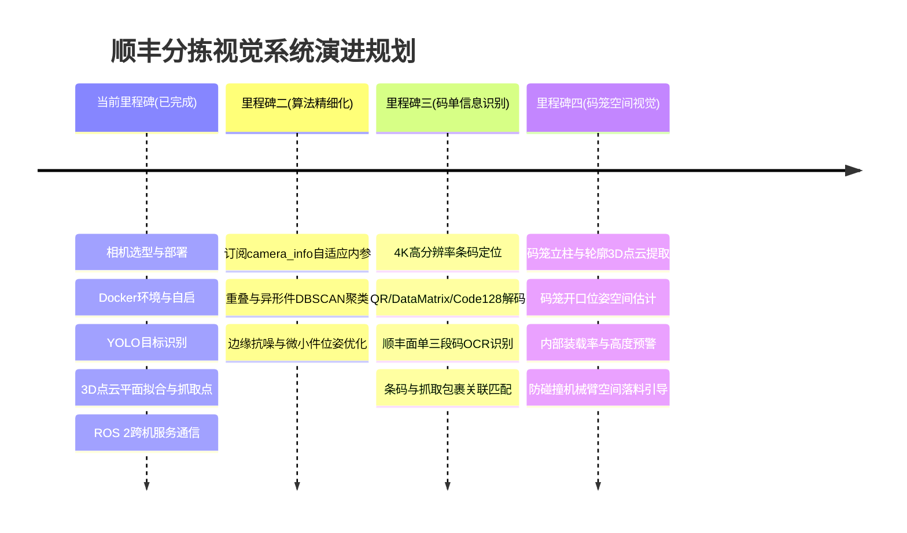

# 顺丰智能分拣视觉感知系统技术沉淀与架构规范

## 1. 系统全景架构 (System Architecture)

本系统面向物流快递包裹高速分拣与机械臂空间抓取场景，构建了从**硬件选型 -> 容器化驱动 -> 实时多模态感知 -> 空间几何解算 -> ROS 2 跨机服务**的全链路闭环。

```mermaid
graph TD
    subgraph Hardware["1. 硬件层"]
        A[Orbbec Femto Bolt 4K RGB-D] -->|USB 3.0 / Type-C| B[8001 主视觉工控机]
        C[8003 协同/控制工控机]
    end

    subgraph Container["2. 容器化与驱动层 (Docker Host)"]
        B --> D[orbbec-femto-bolt 容器]
        D -->|/vision/top_camera/rgb| E[4K 彩色图像流]
        D -->|/vision/top_camera/depth| F[对齐深度图像流]
        D -->|/vision/top_camera/points| G[点云数据流]
        D -->|/vision/top_camera/rgb/camera_info| H[相机内参与畸变系数]
    end

    subgraph Perception["3. 视觉识别与 3D 点云处理 (sf_sorting_server)"]
        E --> I[YOLO 目标检测 (packet_best.pt)]
        I -->|ROI Bounding Box| J[空间棱柱提取 Prism Extract]
        G --> J
        H --> J
        F --> J
        J --> K[RANSAC 空间平面拟合]
        K --> L[Z 最小抓取点计算]
        K --> M[平面法向量与倾斜角 (theta_x, theta_y)]
        K --> N[四边形 3D 边界点顶点解算]
    end

    subgraph Communication["4. 跨机协同通信层 (ROS 2 DDS)"]
        L & M & N --> O[ROS 2 Service: /sf_sorting/get_result]
        C -->|std_srvs/srv/Trigger (DOMAIN_ID=0)| O
        O -->|JSON 格式抓取数据返回| C
    end
```

---

## 2. 核心技术模块沉淀

### 2.1 相机选型与硬件参数
* **选型依据**：采用工业级 **Orbbec Femto Bolt**（集成微软 Azure Kinect 核心 TOF 深度技术 + 4K 超高清 RGB + 6-DoF IMU）。
  * 相比双目结构光，TOF 对黑色快递袋、反光胶带、透明气泡膜适应性更强。
  * 具备硬件级时间戳同步，RGB 与 Depth 原生对齐。
* **标定参数规范（针对 4K 模式 3840x2160）**：
  * **8001 设备**：
    * 内参：$f_x = 2249.6287, f_y = 2248.4431, c_x = 1877.3463, c_y = 1073.7207$
    * 畸变模型：`plumb_bob` ($k_1=0.080384, k_2=-0.107753, p_1=-0.000413, p_2=0.000256, k_3=0.044622$)
  * **8002 设备**：
    * 内参：$f_x = 2248.1819, f_y = 2246.7251, c_x = 1903.3276, c_y = 1098.8224$
    * 畸变系数：`[0.080072, -0.105896, -0.000543, 0.000005, 0.043521, 0, 0, 0]`

### 2.2 工作环境与容器化部署
* **运行镜像**：`orbbec-femto-bolt:humble` (Ubuntu 22.04 LTS + ROS 2 Humble)。
* **网络与设备直通**：
  * `--network host`：共享宿主机物理网络栈，确保 DDS 组播发现零隔离、零延迟。
  * `--ipc host`：支持共享内存通讯加速。
  * `--device-cgroup-rule='c 189:* rmw' -v /dev/bus/usb:/dev/bus/usb`：支持相机 USB 动态热插拔与权限直通。
* **服务生命周期管理**：封装于 `deploy.sh`：
  ```bash
  # 启动后台常驻分拣服务
  bash deploy.sh server start
  # 检查日志与服务状态
  bash deploy.sh server logs
  bash deploy.sh server status
  # 停止服务
  bash deploy.sh server stop
  ```

### 2.3 目标识别与视觉处理
* **检测网络**：轻量化 YOLO 快递专属检测模型（`packet_best.pt`），支持各类纸箱（`carton`）、软包/编织袋（`bag`）及不规则件。
* **视场过滤**：引入自适应掩膜 `mask1.png`，排除输送线外边缘、机械挡板及背景静态反光干扰。

### 2.4 3D 点云处理与空间拟合算法
* **快速零拷贝反序列化**：从 `sensor_msgs/msg/PointCloud2` 原始字节流中按 `point_step` 内存对齐切片，直接提取前 12 字节 float32 作为空间三维坐标 $(X, Y, Z)$，毫秒级完成百万点云转换。
* **空间棱柱过滤 (Prism ROI)**：依据 2D 目标检测框，结合相机内参构建三维视锥棱柱，提取属于当前包裹的目标点云。
* **RANSAC 空间平面拟合**：
  * 估计空间平面方程：$Ax + By + Cz + D = 0$。
  * 计算相对于水平面的空间倾斜角：
    $$\theta_x = \arccos(|C| / \sqrt{B^2 + C^2}), \quad \theta_y = \arccos(|C| / \sqrt{A^2 + C^2})$$
  * 解算包裹上表面的 $Z$ 最小点（空间抓取最高点，防止机械臂下压撞击）。
  * 拟合包裹空间四边形顶点三维坐标（`quad_3d`）。

### 2.5 ROS 2 跨机通信与返回机制
* **协议解耦**：服务端无需维护复杂的自定义消息包，对外暴露 ROS 2 标准服务：
  * 服务名称：`/sf_sorting/get_result`
  * 服务类型：`std_srvs/srv/Trigger`
* **JSON 载荷返回**：
  ```json
  {
    "success": true,
    "timestamp": 1792143338.305,
    "best_label": "carton",
    "x": -322.79,
    "y": 105.35,
    "z": 1264.0,
    "unit": "mm",
    "quad_3d": [
      [-477.94, -176.29, 1173.92],
      [-352.81, -220.81, 1218.79],
      [-139.32, 437.65, 1370.39],
      [-289.08, 452.78, 1312.79]
    ],
    "theta_x_deg": 21.5528,
    "theta_y_deg": 5.8343,
    "cost_sec": 4.5
  }
  ```
* **跨机调用验证**：
  * 8003 作为客户端工控机，归档脚本位于 `/home/caseim/femto_bolt_deploy/call_sorting_client.sh`。
  * 在同一局域网（`ROS_DOMAIN_ID=0`）下调用 8001，端到端耗时 ~4.5 秒，稳定可靠。

---

## 3. 下一阶段研发演进路线 (Roadmap)



### 里程碑 1：分拣算法精细化与鲁棒性提升
1. **动态内参自适应**：服务端从硬编码内参升级为动态订阅 `/vision/top_camera/rgb/camera_info`，当硬件相机更换时实现零修改自适配。
2. **重叠与连体件分割**：引入点云欧氏聚类（Euclidean Cluster Extraction）与深度不连续边界检测，避免两件紧挨的包裹误识别为单一大件。

### 里程碑 2：快递运单/码单视觉识别 (Waybill OCR & Barcode)
1. **多码检测与定位**：利用 4K RGB 画面，结合条码检测器定位面单上的 Code128 条形码及二维码（QR / DM）。
2. **面单信息 OCR**：采用轻量 PaddleOCR / ONNX 模型提取运单号、三段码及集包地路由代号。
3. **数据关联融合**：将识别到的运单单号与空间抓取三维位姿（`x, y, z, theta`）严格绑定，实现“看一眼 -> 知单号 -> 定抓点”。

### 里程碑 3：码笼空间与视觉位姿感知 (Cage Volume & Pose)
1. **码笼边框几何估计**：使用点云 RANSAC 拟合码笼铁栏网与四角立柱，解算码笼在相机坐标系下的 6-DoF 刚体位姿。
2. **码笼装载率与安全落料检测**：
   * 空间体素网格（Voxel Grid）统计码笼内已堆叠货物的最高点与凸包容积。
   * 计算当前装载率（%）并在堆叠超高时发出满笼报警，指导机械臂规划防碰撞落料轨迹。
