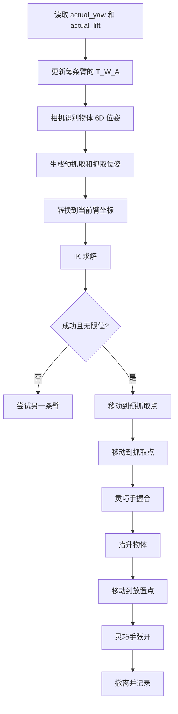

# 双臂分拣坐标转换与流程

更新日期：2026-11-05

## 1. 结论

分拣系统使用固定大地坐标系，升降和旋转改变每条臂的基座位置。每次抓取前，
把大地坐标中的目标位姿转换为当前臂坐标系，再执行 IK，就可以让末端到达固定
大地坐标点。

因此不需要完整机器人的 URDF。只需要：

1. 大地坐标系；
2. 升降高度和旋转角度；
3. 每条臂相对平台的安装变换；
4. 单臂运动学和末端 TCP；
5. 每次下发 6D 位姿，不能只转换 XYZ。

## 2. 坐标系

推荐大地坐标系：

```text
X：机器人正面
Y：机器人左侧
Z：竖直向上
```

使用的坐标系：

| 坐标系 | 含义 |
|---|---|
| `W` | 大地坐标系，固定不变 |
| `P` | 升降旋转平台坐标系 |
| `A3`、`A4` | Robot 3/4 当前臂基座坐标系 |
| `T` | 末端工具/TCP 坐标系 |

## 3. 坐标转换

平台变换：

```text
T_W_P(yaw, lift)
```

臂基座相对平台的固定安装变换：

```text
T_P_A3
T_P_A4
```

当前臂基座在大地坐标系中的位姿：

```text
T_W_A3 = T_W_P * T_P_A3
T_W_A4 = T_W_P * T_P_A4
```

目标末端在大地坐标系中的位姿为 `T_W_T`，转换到臂坐标：

```text
T_A3_T = inverse(T_W_A3) * T_W_T
T_A4_T = inverse(T_W_A4) * T_W_T
```

位置和姿态必须同时转换。只转换 XYZ、继续使用大地坐标 UVW，会使工具方向
随平台旋转产生错误。

## 4. 平台换算

升降：

```text
齿轮一圈 = 167 mm
减速比 = 25:1
电机一圈对应高度 = 167 / 25 = 6.68 mm
```

旋转：

```text
减速比 = 70:1
电机一圈对应旋转 = 360 / 70 = 5.142857°
```

分拣程序需要实时读取：

```json
{
  "lift_mm": 123.4,
  "yaw_deg": 15.0,
  "feedback_valid": true,
  "timestamp_ns": 0
}
```

每次升降或旋转后重新计算 `T_W_A3` 和 `T_W_A4`。

## 5. IK 调用

世界目标应包含位置和姿态：

```text
T_W_T = [ R_W_T  p_W_T ]
        [ 0      1    ]
```

转换后得到臂坐标位姿，再将旋转矩阵转为 UVW：

```text
[x, y, z, U, V, W]
```

厂家 `tryWorlds()` 调用：

```python
result = m.tryWorlds(
    robot_id,
    [x_mm, y_mm, z_mm, U_deg, V_deg, W_deg],
)

ok, joints_deg, pos_limit_mask, neg_limit_mask = result
```

只有以下条件都满足才执行：

```text
ok == True
pos_limit_mask == 0
neg_limit_mask == 0
关节增量没有异常跳变
工作空间和碰撞检查通过
```

使用厂家 `tryWorlds()` 时，目标必须符合控制器世界坐标定义，不能把已经转到
臂基座的坐标再次当作厂家世界坐标传入，否则会重复变换。

## 6. 分拣流程



第一版建议平台先运动到位并锁止，再执行抓取。平台运动时同步控制机械臂的
难度更高，需要高频平台反馈和实时世界坐标闭环。

## 7. 必须标定的内容

### 平台

- 升降零点；
- 升降方向；
- 旋转零点；
- 旋转正负方向；
- 电机位置到实际高度/角度的比例。

### 每条臂

- `T_P_A3`、`T_P_A4`：相对平台的安装旋转和平移；
- 法兰到 TCP 的变换；
- 关节零位；
- 工作空间；
- 奇异区；
- 与平台、立柱和另一条臂的碰撞范围。

### 视觉

- 相机到大地坐标系的 `T_W_C`；
- 物体检测位置；
- 物体抓取姿态和接近方向。

## 8. 当前工控机待补齐

当前平台控制仍主要是速度 × 时间：

```text
升降绝对高度反馈：未完成
旋转实际角度反馈：未完成
旋转角度：软件估算
```

要实现稳定的大地坐标分拣，必须先把平台接口升级为实际位置反馈。否则平台
状态不准确，即使臂的 IK 正确，末端也无法稳定到达固定大地坐标点。

## 9. 最小可行版本

```text
平台移动到工位并锁止
→ 读取实际 lift/yaw
→ 更新臂基座变换
→ 相机输出物体 6D 位姿
→ 转换到当前臂坐标
→ tryWorlds
→ 预抓取、抓取、抬升、放置、撤离
```

该方案不需要完整机器人的 URDF，只需要单臂模型、安装变换和平台实际位置。
